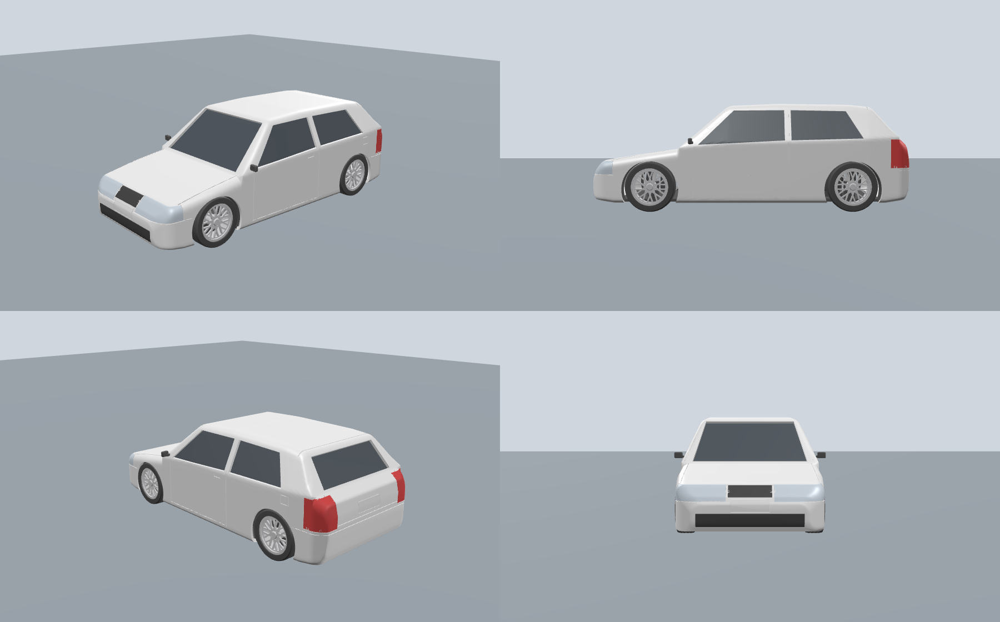

# Gol G4 branco rebaixado com rodas BBS RS aro 17 — kit para impressão 3D

Modelo do VW Gol G4 2 portas, rebaixado (pneu quase encostando no para-lama), com rodas
estilo **BBS RS aro 17** de malha cruzada e pneus 195/45. É um kit **multipartes, uma cor por peça**:
dá para imprimir na **Bambu Lab A1 sem AMS**, trocando o filamento entre as mesas.

- Escala **1:18** → 217,6 mm de comprimento, 92 mm de largura e 6 mm de vão livre
- Cabe na mesa da A1 (256 × 256 mm) com folga
- Tudo é gerado por código (`gerar_gol_g4.py`), então dá para mudar escala, roda etc.



> É uma reprodução estilizada, modelada a partir das dimensões reais do G4: comprimento 3.916 mm,
> entre-eixos 2.468 mm, largura 1.656 mm. Não é um escaneamento da fábrica.

---

## Arquivos

```
3mf/   mesas prontas por cor, com as quantidades certas (abrir direto no Bambu Studio)
stl/   peças avulsas, separadas por cor (o "_x4" no nome indica quantas imprimir)
preview/montagem.glb   carro montado (abre em qualquer visualizador 3D, ex.: 3dviewer.net)
gerar_gol_g4.py        script que gera tudo
```

| Cor do filamento | Peças |
|---|---|
| **Branco** | carroceria, placa dianteira, placa traseira |
| **Preto** | chassi + interior, 4 pneus, 2 retrovisores, volante, grade superior, grade inferior, 2 eixos (opcional) |
| **Prata** (PLA Silk fica ótimo) | 4 rodas |
| **Vermelho** (ou vermelho translúcido) | 2 lanternas |
| **Transparente ou prata** | 2 faróis |
| **PETG transparente** ou **PLA preto** (efeito "insulfilm") | 6 vidros: para-brisa, traseiro, 2 de porta e 2 traseiros laterais |

**Fora da impressora você vai precisar de:**
- vareta de aço ou inox de 3 mm, cortada em 2 pedaços de 86 mm (ou use os eixos impressos);
- cola instantânea (CA) gel;
- cola que não embaça para os vidros (cola branca PVA, cola de contato transparente ou epóxi).

> ⚠️ **Não use cola instantânea nos vidros transparentes:** ela deixa uma névoa branca.

---

## Configurações de impressão (Bambu A1, bico 0.4)

| Peça | Camada | Paredes | Suporte | Observações |
|---|---|---|---|---|
| Carroceria | 0.12 mm | 4 | **Árvore (auto)** | Imprima em pé, como vem no arquivo (aberta para baixo). Os suportes ficam só dentro do carro, então a lataria sai sem marca. Preenchimento é irrelevante, porque a peça é oca. |
| Chassi + interior | 0.16 mm | 3 | Árvore (auto) | O suporte é só para o topo das caixas de roda. |
| Rodas | 0.08 mm | 3 | **Não** | Imprima com a face interna na mesa, como vem no arquivo. Os raios saem em ponte. Use velocidade baixa (perfil "0.08 Extra Fine"). |
| Pneus | 0.12 mm | 3 | Não | Em PLA preto, cole na roda. Em **TPU 95A** ficam com aparência real e entram sob pressão. |
| Vidros | 0.12 mm | 2 | Auto, se pedir | A face externa já vem virada para cima. Para ficarem mais transparentes, use PETG, 100% de preenchimento e "Monotonic line". |
| Faróis, lanternas, grades, placas | 0.08 mm | 2 | Não | São peças curvas e finas, já posicionadas com a face visível para cima. |
| Retrovisores, volante | 0.08 mm | 2 | Não | São peças pequenas: ative "Modo lento para camadas pequenas". |

**Dica:** ao abrir os STL, o Bambu Studio pode avisar "erros de malha reparados". Isso é normal;
são poucas arestas coincidentes que ele mesmo corrige.

---

## Montagem

1. **Acabamento (opcional):** lixe a carroceria (grão 400 → 800), passe primer, pinte de
   branco (o original é o *Branco Cristal* da VW) e finalize com verniz brilhante.
2. **Faróis, lanternas, grades e placas:** cada peça encaixa no rebaixo do formato dela na lataria.
   Fixe com pontos de cola CA gel.
3. **Retrovisores:** o pino entra no furo que fica no triângulo da porta, logo à frente do vidro.
4. **Vidros:** cole por dentro da carroceria, apoiados nas bordas das janelas.
   Ordem: para-brisa, traseiro e depois os laterais.
5. **Volante:** cole no painel, na frente do banco do motorista (lado esquerdo).
6. **Rodas:** encaixe o pneu pelo lado interno da roda; o degrau do pneu acomoda a borda do aro.
7. **Eixos:** passe a vareta de 3 mm pelos dois mancais de cada eixo do chassi e pressione uma
   roda em cada ponta. O furo da roda é cego e justo, então a roda prende sozinha.
   Se ficar apertado demais, passe uma broca de 3 mm.
8. **Chassi:** encaixe pela parte de baixo da carroceria. Ele assenta na aba interna e fica rente
   ao fundo. Cole com 4 pontos de cola ou use fita dupla-face, se quiser poder abrir de novo.

---

## Personalizar (gerar de novo)

Precisa de Python 3:

```bash
pip install manifold3d trimesh shapely numpy networkx lxml
python3 gerar_gol_g4.py                 # padrão: 1:18 com BBS RS
python3 gerar_gol_g4.py --escala 24     # 1:24 (163 mm), escala das miniaturas Revell/Tamiya
python3 gerar_gol_g4.py --roda cup      # rodas Porsche Cup de 5 raios
```

Outros ajustes ficam no começo do script:

| Ajuste | Variável |
|---|---|
| Altura do rebaixamento | `FOLGA_PNEU_TOPO` (vão entre pneu e para-lama, em mm reais) |
| Medida do pneu | `PNEU_D` e `PNEU_L` |
| Espessura da lataria | `PAREDE` |
| Folga dos encaixes (se a sua impressora deixar as peças justas demais) | `FOLGA` |
